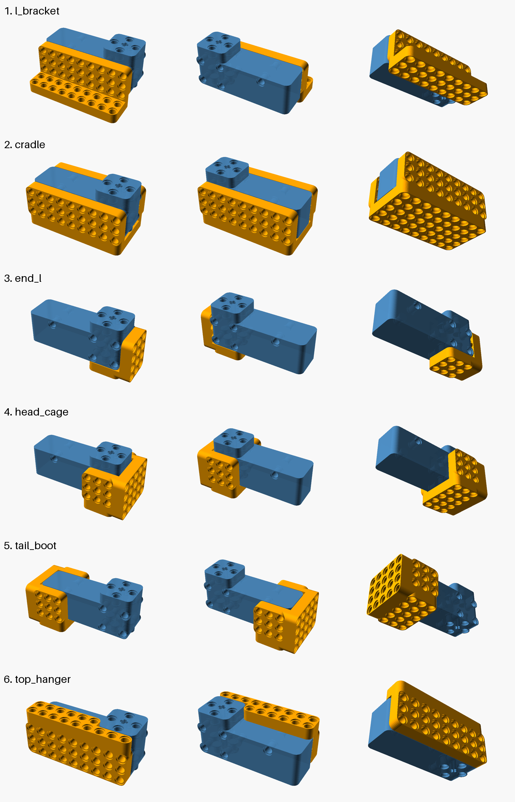

# Motor brackets

Made with Part Designer (headless, `pd.js`) on the motor envelope `motor.stl`. Regenerate with `node designs.js`; check fit with `python verify.py`; view in OpenSCAD with `assembly.scad` (set `part` and `ox/oy/oz` to the origin below).

Each bracket fastens to the motor with standard 2-unit LEGO friction pins. Open the link to edit it in Part Designer.

| Part | What it is | Origin in motor frame (mm) |
|---|---|---|
| [side_plate](https://lego3d.jointheleague.org/?part=1ex14dx19cx1113x11bax1299x13b8x10x17x142x18dx1100x11a3x127ex1399x14fcx14x117x182x1f1x1190x1267x137ex14ddx168cx114x13bx133x171x1d3x1161x1223x1321x1463x13x111x164x1c2x114cx120ax1304x1442x15ccx1cx12ax1b5x113bx11f5x12ebx1425x15abx1785x125x15bx1) | 9x3 side plate, all holes along Y; 5 pins into the motor side | -16, -24, 0 |
| [l_bracket](https://lego3d.jointheleague.org/?part=104x11a7x1282x139dx1500x16b3x18bex146x191x1194x126bx1382x14e1x1690x1897x1afex186x1f5x1258x136bx14c6x1671x1874x1ad7x1da2x1eax1185x1a0y1117y11bey129dy13bcy1523y16day122y151y1cdy1159y1219y1315y1455y15e1y17c1y131y16dy1150x120ex1308x1446x15d0x17aex19e8x168x1c6x11f9x12efx1429x15afx1789x19bfx1c59x1b9x113fx12dax1410x1592x1768x199ax1c30x1f32x1132x11e8x11ey14dy19cy1113y11bay1299y13b8y10y17y12dy169y1c9y1155y1215y1311y1451y11y1dy14fy19ey1115y11bcy129by13bay1521y19y120y16by1cby1157y1217y1313y1453y15dfy1fy12fy1) | Side plate + outward 9x2 foot with vertical holes (motor upright, axle vertical) | -16, -40, -8 |
| [cradle](https://lego3d.jointheleague.org/?part=119y11c0y129fy13bey1525y16dcy18eby153y1a2y115by121by1317y1457y15e3y17c3y19ffy16fy1cfy1286x13a1x1504x16b7x18c2x1b2dx1e00x1108x11abx1386x14e5x1694x189bx1b02x1dd1x11110x1198x126fx14cax1675x1878x1adbx1da6x110e1x11494x125cx136fx11c2y12a1y13c0y1527y16dey18edy1b5cy1a4y111by121dy1319y1459y15e5y17c5y1a01y1ca1y1d1y115dy130cx144ax15d4x17b2x19ecx1c8ax1f94x1154x1212x142dx15b3x178dx19c3x1c5dx1f63x112ddx11fdx12f3x1596x176cx199ex1c34x1f36x112acx1169ex12dex1414x142x18dx1100x11a3x127ex1399x14fcx14x117x182x1f1x1190x1267x137ex14ddx168cx114x13bx1e6x1181x1254x1367x14c2x166dx1870x138x17bx11ey14dy19cy1113y11bay1299y13b8y10y17y12dy169y1c9y1155y1215y1311y1451y11y1dy164x1c2x114cx120ax1304x1442x15ccx1cx12ax1b5x113bx11f5x12ebx1425x15abx1785x125x15bx112ex11e4x12d6x140cx158ex1764x1996x156x1acx14fy19ey1115y11bcy129by13bay1521y19y120y16by1cby1157y1217y1313y1453y15dfy1fy12fy1a0y1117y11bey129dy13bcy1523y16day122y151y1cdy1159y1219y1315y1455y15e1y17c1y131y16dy1) | U-cradle: both side plates + 9x5 floor; 14 pins into the motor, axle passes through the floor | -16, -24, -8 |
| [face_plate](https://lego3d.jointheleague.org/?part=53y1a2y1119y11c0y129fy16fy1cfy115by121by1317y1a4y111by11c2y12a1y13c0y1d1y115dy121dy1319y1459y10y17y11ey14dy19cy11y1dy12dy169y1c9y19y120y14fy19ey1115y1fy12fy16by1cby1157y122y151y1a0y1117y11bey131y16dy1cdy1159y1219y1) | 5x5 plate centred on the axle; 4 pins into the bottom face, axle through the centre | 24, -24, -8 |
| [face_l_bracket](https://lego3d.jointheleague.org/?part=502z15d1z1692z178az1876z199bz153y1a2y1119y11c0y129fy13bez1468z16fy1cfy115by121by1317y16b7z17b1z189bz19c2z1adbz1c33z1a4y111by11c2y12a1y13c0y1527z15f8z1d1y115dy121dy1319y1459y11a3z1209z1267z12eaz1367z140bz10y17y11ey14dy19cy1113z1160z11y1dy12dy169y1c9y1280z1305z1380z1426z14c4z158fz19y120y14fy19ey1115y11bcz1224z1fy12fy16by1cby1157y139dz1445z14e1z15aez1671z1767z122y151y1a0y1117y11bey129dz1324z131y16dy1cdy1159y1219y1) | Face plate under the head + 1x5x3 wall at the +X end with X-axis holes | 24, -24, -8 |
| [output_crank](https://lego3d.jointheleague.org/?part=29dy13bcy1523y1315y1455y15e1y1113y11bay1299y1155y1215y1311y120y14fy19ey1115y11bcy129by23bay19y12fy16by1cby1157y1217y1313y2453y1fy1) | Hub on the rotating head (axle + 4 pins) with a 5-hole arm | -8, -16, 32 |
| [right_angle_block](https://lego3d.jointheleague.org/?part=22x151x1a0x1117z1164z146x191x1104x11a7z120dz186x1f5x1194x126bz12eez137x175x1d7x168x1c6x1150x1b9x113fx11f9x10y17y11ey14dz170z11y1dy12dy14y117y142y18dz1c1z1ay126y15ey114y13by182y1f1z113az123y157y1afy19y120y14fy19ez1d4z1fy12fy16by119y144y18fy1102z114dz128y160y1bcy13dy184y1f3y1192z11f6z159y1b1y1135y1) | Pins into the 2x2 side holes at the head end; offers X and Z holes | 32, -40, 0 |

